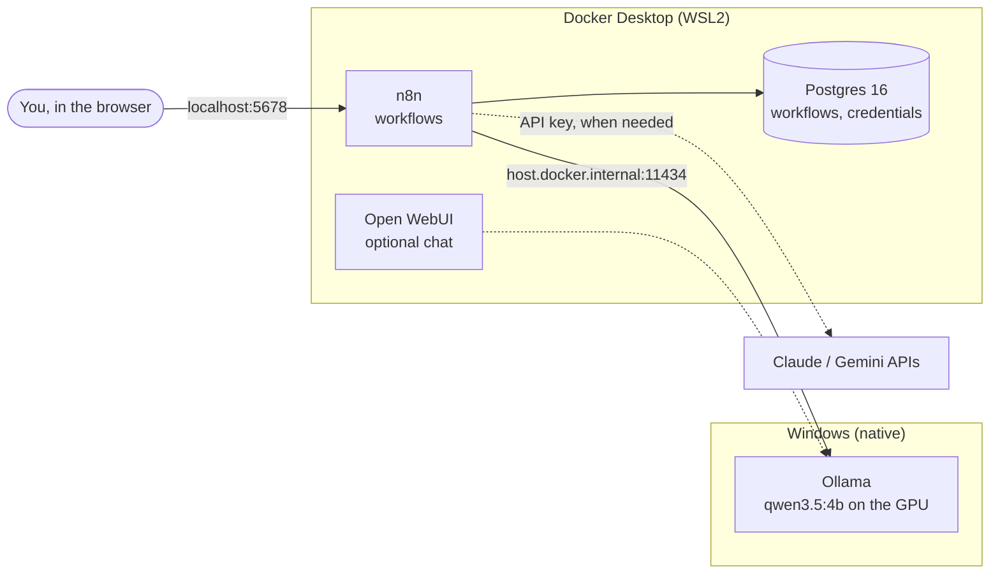
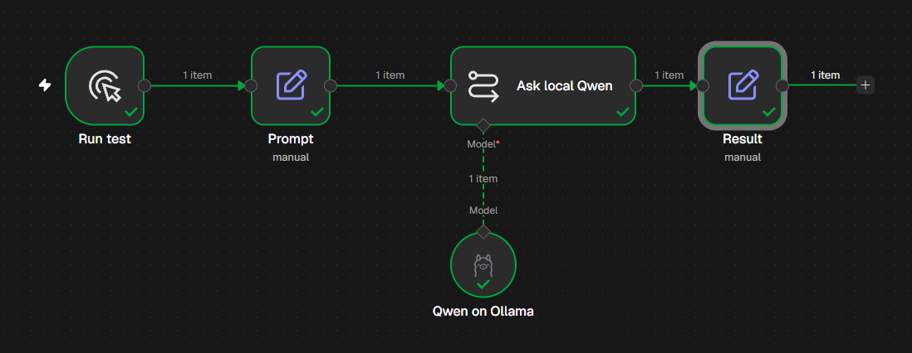
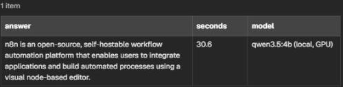

# Local AI Stack

A private, free AI automation setup that runs on one Windows gaming laptop: **n8n** for workflows, **Postgres** to store them, and **Ollama** running an open model (**Qwen**) on the GPU. Cloud models (Claude, Gemini) plug in when a job needs them.

I use it to build and test the workflows in [n8n-ai-workflows](https://github.com/zain-zilla/n8n-ai-workflows) without paying for n8n Cloud or sending data off the laptop.

| | |
|---|---|
| **Cost** | $0 a month (cloud models are pay-per-use and optional) |
| **Privacy** | Everything listens on `127.0.0.1` only; local model data never leaves the laptop |
| **Tested on** | Lenovo Legion 5 Pro, RTX 3070 Laptop (8 GB VRAM), Windows 11 + WSL2 |
| **Set-up time** | About an hour, most of it downloads |

---

## How it fits together



**Why Ollama runs on Windows, not in Docker:** it gets the NVIDIA GPU directly, with no extra container GPU setup. Containers reach it through `host.docker.internal`.

## What's in this repo

| File | What it's for |
|---|---|
| [`docker-compose.yml`](docker-compose.yml) | n8n + Postgres, plus Open WebUI behind an optional `chat` profile |
| [`.env.example`](.env.example) | The two secrets the stack needs. Copy to `.env` (never committed) |
| [`docs/wslconfig.example`](docs/wslconfig.example) | Caps Docker at 12 GB RAM / 8 CPUs so the rest of the laptop stays usable |
| [`scripts/start.ps1`](scripts/start.ps1) | One command: checks Docker and Ollama, starts the stack, opens n8n |
| [`scripts/backup.ps1`](scripts/backup.ps1) | Dumps the n8n database to `backups/` |
| [`workflows/local-qwen-test.json`](workflows/local-qwen-test.json) | A 5-step workflow that proves n8n can talk to the local model |

---

## Set it up (Windows)

**1. Install the tools**
- [Docker Desktop](https://www.docker.com/products/docker-desktop/) (WSL2 backend)
- [Ollama](https://ollama.com/download)
- Optional: copy [`docs/wslconfig.example`](docs/wslconfig.example) to `C:\Users\<you>\.wslconfig`, then run `wsl --shutdown`

**2. Get a local model**
```powershell
ollama pull qwen3.5:4b
ollama run qwen3.5:4b "Say hi"
ollama ps        # PROCESSOR should say 100% GPU
```
A 4B model (about 3 GB) fits fully in 8 GB of VRAM. Bigger models spill onto the CPU and get much slower.

**3. Configure**
```powershell
git clone https://github.com/zain-zilla/local-ai-stack
cd local-ai-stack
copy .env.example .env
notepad .env     # set POSTGRES_PASSWORD and N8N_ENCRYPTION_KEY
```

**4. Start**
```powershell
powershell -ExecutionPolicy Bypass -File scripts\start.ps1
```
or just `docker compose up -d`. Open <http://localhost:5678> and create the n8n owner account.

**5. Connect n8n to the local model**
1. In n8n: **Overview → Credentials → Create credential → Ollama**.
2. Set **Base URL** to `http://host.docker.internal:11434` (not `localhost`: inside Docker, `localhost` means the container itself).
3. Save. You should see **Connection tested successfully**.
4. Import [`workflows/local-qwen-test.json`](workflows/local-qwen-test.json), select that credential in **Qwen on Ollama**, and click **Execute workflow**.



Result from my laptop (first run, including loading the model into VRAM):



**6. Optional: cloud models**
Add **Anthropic** (Claude) and **Google Gemini** credentials the same way. A free Gemini key comes from [Google AI Studio](https://aistudio.google.com/). The [Claude vs Gemini](https://github.com/zain-zilla/n8n-ai-workflows#4-claude-vs-gemini) workflow uses both.

---

## Daily use

| I want to... | Do this |
|---|---|
| Start everything | `scripts\start.ps1` (or open Docker Desktop and Ollama; n8n starts itself) |
| Chat with the local model in a browser | `docker compose --profile chat up -d`, then <http://localhost:3000> |
| Stop | `docker compose down` (workflows and credentials stay in the volumes) |
| Update n8n | `docker compose pull`, then `docker compose up -d` |
| Back up | `scripts\backup.ps1`, and keep a copy of `.env` with it |

## Things I ran into

- **Free up VRAM first.** Other apps were holding 2.3 GB of VRAM. Switching the laptop to Hybrid Mode (Lenovo Vantage) dropped idle use to 1.3 GB, which let the model run 100% on the GPU.
- **First answer is slow, then fast.** The first call loads the model into VRAM (about 30 s here). Later calls skip that.
- **Context length stayed at 4K.** My first attempt to raise it to 8K didn't take effect. The Ollama app's settings have a context-length slider; that's the next thing to try.
- **`localhost` vs `host.docker.internal`.** The most common reason n8n "can't find Ollama".
- **Keep `N8N_ENCRYPTION_KEY` safe.** n8n encrypts every saved API key with it. Lose it and you re-enter all credentials.

## Security notes

- Ports are bound to `127.0.0.1`, so nothing is reachable from your Wi-Fi network or the internet.
- `.env` is in `.gitignore`. Only `.env.example` (with placeholders) is in the repo.
- API keys live inside n8n, encrypted, not in files.

## What's next

- Move to a small VPS (same `docker-compose.yml`, Postgres 17, HTTPS reverse proxy) when a workflow must run 24/7.
- Add local Qwen as a third branch in the Claude vs Gemini workflow, and log time and cost per answer (model routing).

## Built with

Docker Compose · n8n · Postgres · Ollama · Qwen · Open WebUI · PowerShell

## Author

**ZAINSHAZ (Zilla)** · [github.com/zain-zilla](https://github.com/zain-zilla)

## License

[MIT](LICENSE)
